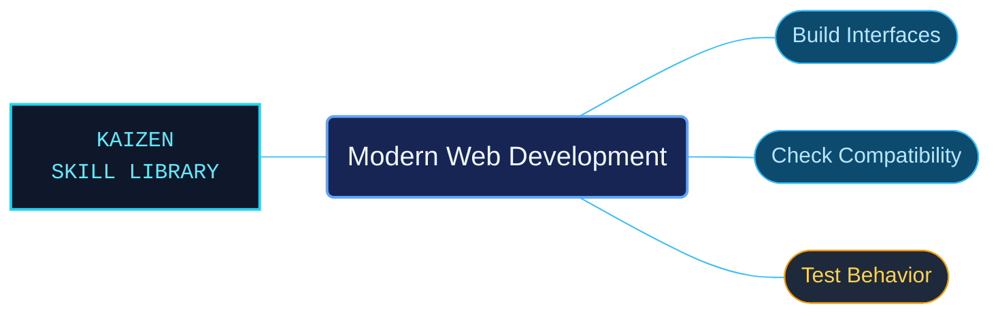

# Modern Web Development

Find implementation guidance, browser fallbacks and matching behavior criteria for a web development task. Most topic indexes bring together the authored guide and available published edition; the site metadata topics are guides written for this skill.

Use when consulting modern web platform guidance for HTML, CSS, JavaScript, accessibility, forms, browser APIs, performance, security, PWA installation, Chrome extensions or browser compatibility, including authored guidance, published editions and behavior expectations; or when writing site metadata (head tags, Open Graph, X cards, Apple link previews, JSON-LD rich results, hreflang, robots rules, AI crawlers and usage preferences, sitemaps, IndexNow, feeds, icons, image rights and C2PA, app links, llms.txt, ads.txt, security.txt and well-known files), titles, descriptions and share images, or previewing and auditing link cards and metadata before deployment.

## What this skill helps with

- Build and validate [form controls](references/form-controls/index.md).
- Compare [feature support and fallbacks](references/feature-support/index.md).
- Diagnose [loading and rendering](references/rendering-performance/index.md).
- Preview, audit and fix [site metadata](references/site-metadata/index.md) with bundled scripts that build link-card mockups, share images, icons and site files and check them against their standards.

## The work behind the references

The references retain captured prose, source metadata and code examples. Named sections keep longer guides navigable. The source links at the bottom of content pages identify the original edition and applicable terms. The site metadata references are written for this skill; each page lists the primary sources it rests on.

## Start here

Start with [SKILL.md](SKILL.md) and follow its context routes.

Authored guides can contain upstream template expressions. Consult the published edition for expanded guidance where available. Verify support in the browser or WebView used by the application.

Search the local references or run a prepared browser grader with the [local tools](references/local-tools.md).

## Sources and license

Skill reference documentation is interpreted content for use in open source projects. Check against [official documentation sources](https://github.com/GoogleChrome/modern-web-guidance-src) when dealing with defects or issues that may come up from interpreting this skill's references.

Licensed under **Apache-2.0**; see [LICENSE](LICENSE). Part of the [Agent Kaizen](https://github.com/LevyBytes/agent-kaizen) skill library.
