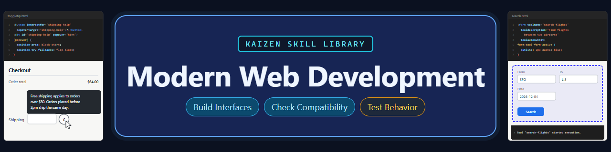

# Modern Web Development Agent Skill



Gives Claude Code, Codex and other coding agents the GoogleChrome Modern Web Guidance as 329 topics in 1,614 reference pages: HTML and web components, CSS layout, forms, interface components, interaction and motion, accessibility, performance, security and passkeys, installable web apps, built-in AI APIs, WebMCP and Chrome extensions. Most upstream guides come in three editions: the authored guide, the published edition and behavior criteria to test an implementation against. It also includes a site metadata toolkit that mocks a page's link cards on 20 search, social and chat platforms, renders share images and icons, and audits head tags and site files.

## Install

```sh
npx skills add LevyBytes/AI-SKILL-modern-web-development -g
```

This installs the skill as `modern-web-development` for each coding agent it finds on your computer; without `-g` it goes into the current project only. The command needs Node.js 22.20 or later.

<details>
<summary>Install without Node.js</summary>

Clone the repository into your agent's skills folder:

| Agent | Command |
| --- | --- |
| Claude Code | `git clone https://github.com/LevyBytes/AI-SKILL-modern-web-development ~/.claude/skills/modern-web-development` |
| Codex | `git clone https://github.com/LevyBytes/AI-SKILL-modern-web-development ~/.agents/skills/modern-web-development` |

</details>

## Use

Ask your agent about web development as usual; it loads the skill when a task matches. You can also call it by name with `/modern-web-development` in Claude Code or `$modern-web-development` in Codex.

- "How do I style a `<select>` with `appearance: base-select`, and what do older browsers show?"
- "How do I find which interactions cause a poor INP score?"
- "How do I register and sign in with a passkey?"
- "How do I expose this form to AI agents as a WebMCP tool?"
- "Preview this page's link card on Discord, Slack and iMessage, and audit its head tags."

## What's inside

| Area | Topics | Covers |
| --- | ---: | --- |
| [HTML and web components](references/document-structure/index.md), [accessible interfaces](references/accessible-interfaces/index.md) | 15 | Semantic HTML, custom elements, shadow DOM, form-associated and accessible web components, camera, microphone and location capture, accessible names, error announcements, OS text scaling |
| [CSS layout and the cascade](references/layout-and-cascade/index.md), [visual presentation](references/visual-presentation/index.md) | 47 | Responsive and size-aware styling, CSS conditionals, `:has()`, fluid scaling, masonry, intrinsic sizing, typography, color ramps and contrast color, dark mode, scrollbar styling, shapes, canvas and WebGL |
| [Form entry and selection](references/form-controls/index.md) | 27 | Labels and fieldsets, autofill for address, payment, sign-in and sign-up forms, validation timing, IME-safe submit, SMS one-time codes, customizable select, combobox, sliders, switch, rating, tree view |
| [Interface components](references/interface-components/index.md), [interface details](references/interface-details/index.md) | 42 | Dialogs, menus, toolbars, tabs, accordions, navigation, data grids, carousels, media controls, toasts, progress and skeletons, viewport-aware dropdowns and tooltips, sticky headers, scroll indicators, text overflow, list markers |
| [Interaction patterns](references/interaction-patterns/index.md), [adaptive experiences](references/adaptive-experiences/index.md) | 50 | Popovers and dialog dismissal, interest-triggered tooltips, drag and drop, sorting, spatial navigation, swipe gestures, scroll snap and scroll-driven effects, view transitions, client-side routing, form-factor and preference-aware interfaces |
| [JavaScript and time](references/client-data/index.md), [loading and responsiveness](references/rendering-performance/index.md) | 35 | Global events, calendar systems and high-precision timestamps; image, preload and script priority, lazy loading, HTML streaming, long tasks and scheduling, INP diagnosis, analytics batching |
| [Browser security and identity](references/browser-security/index.md), [browser privacy](references/privacy-controls/index.md) | 18 | Passkeys, email ownership checks, origin validation, HTML sanitizing and Trusted Types, external subresources, outbound connection limits, local network access, digital signatures, client-side encryption, privacy boundaries |
| [Installed web applications](references/installed-web-apps/index.md) | 11 | Installation, the web app manifest, origin migration, offline loading and updates, background sync, badging and notifications, OS sharing, launch and file handling, custom title bars |
| [Site metadata](references/site-metadata/index.md) | 27 | Head tags, titles and descriptions, Open Graph, X cards, Apple previews, share images, icons, JSON-LD, robots rules and sitemaps, AI crawlers and usage preferences, feeds, app links, security.txt, ads.txt, the preview gallery and metadata audit |
| [Built-in model APIs](references/browser-models/index.md), [WebMCP tools](references/web-tools/index.md), [WebAssembly builds](references/webassembly-builds/index.md) | 8 | Prompt API, Language Detector, Summarizer and Translator; WebMCP tools and agentic forms; C and C++ compiled for the browser |
| [Chrome extension development](references/extension-development/index.md), [Chrome Web Store preparation](references/extension-distribution/index.md) | 24 | Manifest V3 service workers, content scripts, messaging, permissions, side panel, declarative net request, storage, DevTools; store listing, privacy policy, review checklist |
| [Feature support and fallbacks](references/feature-support/index.md) | 20 | Feature detection, fallbacks and polyfills for anchor positioning, popover, customizable select, Temporal, `light-dark()`, interest invokers and more; origin trials, pending and volatile features |
| [Upstream tools and evaluation](references/upstream-operations/index.md) | 5 | The upstream retrieval workflow, evaluation harness, benchmark vocabulary and results |

The 329 topics are 253 upstream guides (210 with a published edition and 213 with behavior criteria), 28 guides written for this skill and 48 upstream source documents.

| Tool | What it does |
| --- | --- |
| [`scripts/lookup.ts`](references/local-tools.md) | Searches the references by task (lexical, with an optional semantic signal), retrieves a guide in a chosen edition, lists an area, and verifies or rebuilds the index. Node.js 22.18 or later, built-in modules only, no network. |
| [`scripts/run-grader.ts`](references/local-tools.md#grade-a-local-implementation) | Runs your Playwright grader against a local implementation, and against a failing control to confirm the grader catches the defect; `grader-lint.ts` checks grader assertions and naming. Playwright from `scripts/package.json`. |
| [`scripts/share-previews/`](references/site-metadata/preview-gallery.md) | Builds 20 search, social and chat mockups per page before and after proposed metadata; renders share cards and icons; proposes robots.txt, a sitemap, security.txt, llms.txt, ads.txt, the web app manifest and `.well-known` files; audits head tags and site files. The site changes only when `apply-proposals.ts --write` runs, and no script runs Git. 80 end-to-end checks and 34 rule tests. |

Authored guides can contain upstream template expressions; the published edition has them expanded where one exists. Verify support in the browser or WebView the application targets.

## When agents load this skill

Use when consulting modern web platform guidance for HTML, CSS, JavaScript, accessibility, forms, browser APIs, performance, security, PWA installation, Chrome extensions or browser compatibility, including authored guidance, published editions and behavior expectations; or when writing site metadata (head tags, Open Graph, X cards, Apple link previews, JSON-LD rich results, hreflang, robots rules, AI crawlers and usage preferences, sitemaps, IndexNow, feeds, icons, image rights and C2PA, app links, llms.txt, ads.txt, security.txt and well-known files), titles, descriptions and share images, or previewing and auditing link cards and metadata before deployment.

## The work behind the references

The references keep the captured prose, source metadata and code examples, with named sections that keep long guides navigable. A source link at the bottom of each content page identifies the original edition and its terms. The site metadata guides are written for this skill, and each page lists the primary sources it rests on.

## Contributing

Pull requests are accepted from approved contributors only. To propose a fix or a feature, first open an issue that describes the change your pull request would make, such as a guide that no longer matches the upstream Modern Web Guidance or a platform whose link card changed, and the source it should match. The maintainer reviews the issue and your GitHub account, then approves or declines. New maintainers are approved the same way. See [CONTRIBUTING](.github/CONTRIBUTING.md).

## Sources and license

Skill reference documentation is interpreted content for use in open source projects. Check against [official documentation sources](https://github.com/GoogleChrome/modern-web-guidance-src) when dealing with defects or issues that may come up from interpreting this skill's references.

Licensed under **Apache-2.0**; see [LICENSE](LICENSE). Part of the [Agent Kaizen](https://github.com/LevyBytes/agent-kaizen) skill library.
